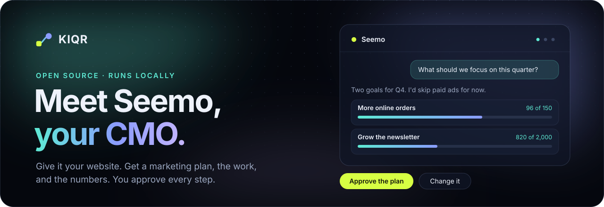
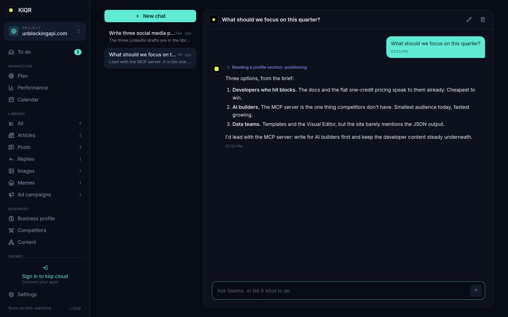
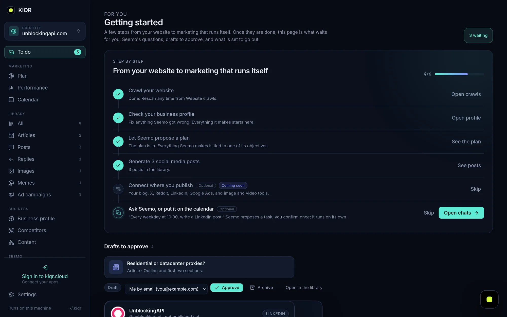

<p align="center">
  <a href="https://kiqr.dev"></a>
</p>

<p align="center">
  <a href="https://kiqr.dev"></a>
  <a href="https://kiqr.dev/docs/install"></a>
  <a href="https://kiqr.dev/abilities"></a>
  <a href="LICENSE"></a>
  <br>
  
  
  
  
</p>

<p align="center">
  <b>KIQR is an open-source AI marketer that lives on your computer.</b><br>
  Its name is Seemo. It reads your website, proposes a marketing plan with real numbers to hit,<br>
  does the work, checks your analytics every morning, and asks before anything goes out.
</p>

<p align="center">
  <a href="#-hire-seemo-in-one-line">Install</a> ·
  <a href="#-how-it-works">How it works</a> ·
  <a href="#-a-look-inside">Screenshots</a> ·
  <a href="https://kiqr.dev/docs">Docs</a> ·
  <a href="#-contribute-to-kiqr">Contribute</a>
</p>

<br>

## ☕ Hire Seemo in one line

No interview. No salary negotiation. No onboarding deck. Paste this into a terminal on macOS or Linux:

```sh
curl -fsSL https://kiqr.dev/install.sh | sh
```

On Windows, in PowerShell:

```powershell
irm https://kiqr.dev/install.ps1 | iex
```

<p align="center">
  
</p>

Then open **[http://127.0.0.1:4040](http://127.0.0.1:4040)**, paste your website's address, and go make that coffee. By the time you're back, Seemo has read the whole site.

KIQR runs in the background and starts when you log in, so there is nothing to keep open. `kiqr status` says whether it is running, and `kiqr start`, `kiqr stop` and `kiqr restart` do what they say.

<details>
<summary><b>Rather use Docker?</b></summary>

<br>

```sh
docker run -d -p 4040:4040 -v kiqr-data:/data --env-file .env ghcr.io/kiqr/kiqr
```

Put `ANTHROPIC_API_KEY` or `OPENAI_API_KEY` in `.env`, or a subscription token from `claude setup-token` as `CLAUDE_CODE_OAUTH_TOKEN`.

</details>

**What you need:** a Claude or ChatGPT plan you already pay for (through Claude Code or Codex), or an API key. That's the brain. KIQR itself is free.

**Staying current:** KIQR tells you when a new version is out, in Settings and in `kiqr status`. Click **Update** in Settings or run `kiqr update`. Running the installer again does the same. To have it install new versions on its own, as on a server, run `kiqr update --auto on` or switch on Updates in Settings.

<br>

## ✨ How it works

Think of Seemo as a senior marketer who joined this morning and read your whole website before the first meeting.

<table>
  <tr>
    <td width="50%" valign="top">
      <h3>1 · It learns your business</h3>
      Give it your website. Seemo reads every page and writes down what you sell, to whom, against whom and in what voice. Every fact links back to the page it came from, so you can check it. If your site doesn't say it and you didn't say it, Seemo doesn't make it up.
    </td>
    <td width="50%" valign="top">
      <h3>2 · It proposes a plan</h3>
      Two to four goals for the quarter, each with one number to hit: more online orders, a bigger newsletter, more demo requests. You approve the plan or change it. Everything Seemo makes after that is tied to one of those goals.
    </td>
  </tr>
  <tr>
    <td width="50%" valign="top">
      <h3>3 · It does the work</h3>
      Social posts, articles, emails and replies, each with an on-brand image made from your own colours, fonts and logo. Drafts show up exactly as they'll look. Nothing goes out until you say yes, and you can let it publish on its own once you trust a channel.
    </td>
    <td width="50%" valign="top">
      <h3>4 · It checks the numbers</h3>
      Every morning it reads your analytics and compares each goal against its target. Ask "how did last week go?" and you get a straight answer with a suggestion, like adding a newsletter box to the blog because sign-ups dipped.
    </td>
  </tr>
</table>

And it keeps a rhythm. Say *"every Monday at 9, review last week and tell me what to change"* once, and it does, every Monday.

### Why on your machine?

- **Your data stays yours.** Everything is plain files in a folder on your computer. No KIQR account, no database in someone else's cloud. The one thing KIQR sends us is an anonymous usage ping (version, OS, which marketplace abilities); `kiqr telemetry off` stops it ([what it holds](https://kiqr.dev/docs/cloud#the-usage-ping)).
- **Your AI, your bill.** It runs on the Claude or ChatGPT plan you already have. No extra subscription.
- **Teach it like a colleague.** "Here's how we write a product update." Write it once in plain words and Seemo does it that way every time. Or install **abilities** from the [marketplace](https://kiqr.dev/abilities): Google Analytics, Search Console, Plausible, WordPress, email and more.

<br>

## 👀 A look inside

<table>
  <tr>
    <td width="50%"><p align="center"><b>The plan.</b> Goals with numbers to reach.</p></td>
    <td width="50%"><p align="center"><b>Strategy.</b> Ask it what a CMO would know.</p></td>
  </tr>
  <tr>
    <td width="50%"><p align="center"><b>Performance.</b> Every goal against its target.</p></td>
    <td width="50%"><p align="center"><b>Library.</b> The work that moves the numbers.</p></td>
  </tr>
  <tr>
    <td colspan="2"><p align="center"><b>Approvals.</b> Nothing goes out without your yes.</p></td>
  </tr>
</table>

<br>

## 💬 Try saying

> What do you know about us?

> What should we focus on this quarter?

> Write two Facebook posts for Halloween, with images.

> How did last week go?

The full walkthrough is in **[Your first project](https://kiqr.dev/docs/first-project)**.

<br>

---

<br>

## 🛠 Contribute to KIQR

KIQR is one Rust binary: a daemon with the React UI embedded, a CLI that talks to it, and an MCP server so Seemo runs as a Claude Code session with KIQR's own tools and nothing else. Issues and pull requests are welcome.

### Build from source

You need Rust (stable) and Node.js.

```sh
cd web && npm ci && npm run build && cd ..      # the UI, embedded into the binary
cargo build
KIQR_HOME=/tmp/kiqr-dev ./target/debug/kiqr daemon   # a throwaway home
```

`npm run dev` in `web/` serves the UI with hot reload and proxies `/api` to a daemon on port 4040. Preview UI changes without a daemon through the demo build: `npx vite build -c vite.demo.config.ts`, then open `web/dist-demo/index.html?demo`.

For crawl tests, serve a folder of HTML files with `python3 -m http.server 8099` and run `./target/debug/kiqr project add http://127.0.0.1:8099/ --watch`.

### Releases

Versions follow [semver](https://semver.org). Before 1.0, a minor release (0.x.0) brings new features and may change the `~/.kiqr` layout or the API, and a patch release (0.x.y) only fixes things. To cut one from an up-to-date `main`:

```sh
scripts/release.sh minor --dry-run    # see the version and changelog entry
scripts/release.sh minor              # or patch, major, rc, or an exact 0.4.0-rc.1
```

The script bumps `Cargo.toml`, rebuilds `web/dist`, moves "Unreleased" in [CHANGELOG.md](CHANGELOG.md) under the new version (or lists the commits since the last tag when it is empty), commits `Release vX.Y.Z`, tags and pushes. The tag starts [the release workflow](.github/workflows/release.yml), which builds Linux (x86_64, arm64, static musl), macOS (Intel, Apple silicon) and Windows (x64, arm64) and publishes a GitHub Release with the archives, `SHA256SUMS` and `latest.json`, the manifest the installers and `kiqr update` read. An `-rc.N` version becomes a pre-release that installs and updates skip unless asked for (`KIQR_VERSION=v0.4.0-rc.1`).

### Find your way around

| Where | What |
| --- | --- |
| `crates/kiqr-core` | Storage (files + git), events, the crawler, the profile, providers, Seemo's tools, the plan, metrics |
| `crates/kiqr-daemon` | The axum API, server-sent events, the embedded UI, publishing, the scheduler |
| `crates/kiqr` | The `kiqr` binary: CLI, `kiqr daemon`, `kiqr mcp` |
| `web/` | React + Vite + TypeScript |
| `abilities/` | The abilities that ship in the binary. Everything else lives in [kiqr/marketplace](https://github.com/kiqr/marketplace) |
| `seemo/PERSONA.md` | Seemo's standing instructions |

Read **[docs/PLAN.md](docs/PLAN.md)** for the architecture and the decisions behind it, **[DESIGN.md](DESIGN.md)** before touching `web/`, **[docs/abilities.md](docs/abilities.md)** for the ability format, and **[CLAUDE.md](CLAUDE.md)** for the house rules.

### Under the hood

- **No database.** `~/.kiqr` holds everything as YAML and Markdown in a local git repository. The daemon is the only writer and commits after every change with a readable message. KIQR never pushes; add a remote yourself if you want a backup.
- **Secrets only in `.env`** files (mode 0600, ignored by git). Config refers to them by name; values are never shown or sent to the model.
- **The CLI never touches files.** It calls the daemon's API. A new capability gets an API route first, then the CLI and the UI.
- **Modular by default.** Anything that could be replaced by something else is an ability: a folder with `SKILL.md` instructions, an `extension.yaml` manifest, or both. Core names no app or platform.
- **Approvals for side effects.** Seemo acts only through KIQR's tools, and anything a person should see first (tasks, settings, new abilities, channels, publishing, email) goes through a card you approve.
- **The crawler** reads up to 200 pages per site. Pages that block crawlers or need JavaScript are retried through [UnblockingAPI](https://unblockingapi.com) if you add a key.
- **Models per task** are set in `~/.kiqr/config.yaml` as `provider/model`: `claude-cli/haiku`, `anthropic/claude-sonnet-5-5`, `openai/gpt-5-mini`, `codex-cli/gpt-5`.

<details>
<summary><b>CLI reference</b></summary>

<br>

```
kiqr start | stop | restart      the background service the installer registered
kiqr status                      running or not, version, service, models, home directory
kiqr update [--check]            update KIQR to the latest release
kiqr update --auto on|off        install new releases on their own, or only say so
kiqr daemon                      run the daemon in this terminal (serves the web UI)
kiqr project add <url> [--watch]
kiqr project list
kiqr crawl <slug> [--watch] [--max-pages N]
kiqr profile <slug> [--yaml]
kiqr synthesize <slug>
kiqr history <slug>
kiqr events [--project <slug>]
kiqr chat <slug>                 talk to Seemo from the terminal
kiqr todo <slug>                 what waits for you: approvals, drafts, publishes coming up
kiqr assets ls|show|approve|publish|schedule|unpublish|archive|rm
kiqr abilities ls|show|teach|install|update|pause|resume|rm
kiqr secrets set <NAME> [--project <slug>]
```

More in the [CLI docs](https://kiqr.dev/docs/cli).

</details>

<br>

## License

[AGPL-3.0](LICENSE). The optional gateway for one-click app connections lives at [kiqr.cloud](https://kiqr.cloud); nothing in the core is gated.

<p align="center">
  <br>
  <a href="https://kiqr.dev"></a><br>
  <sub>Made in Malta · <a href="https://kiqr.dev">kiqr.dev</a></sub>
</p>
